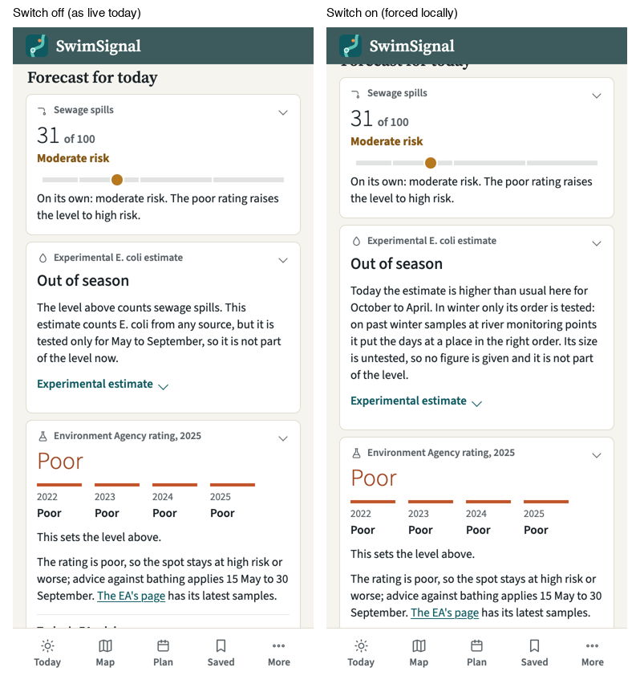
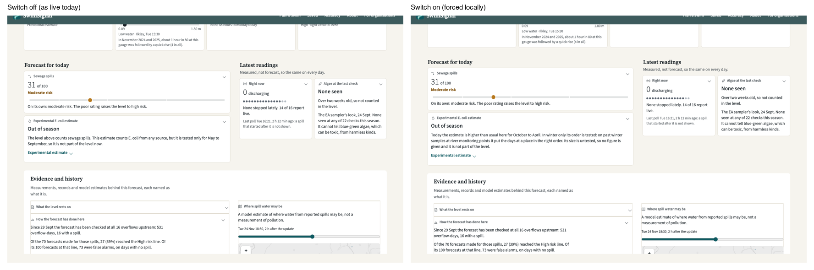
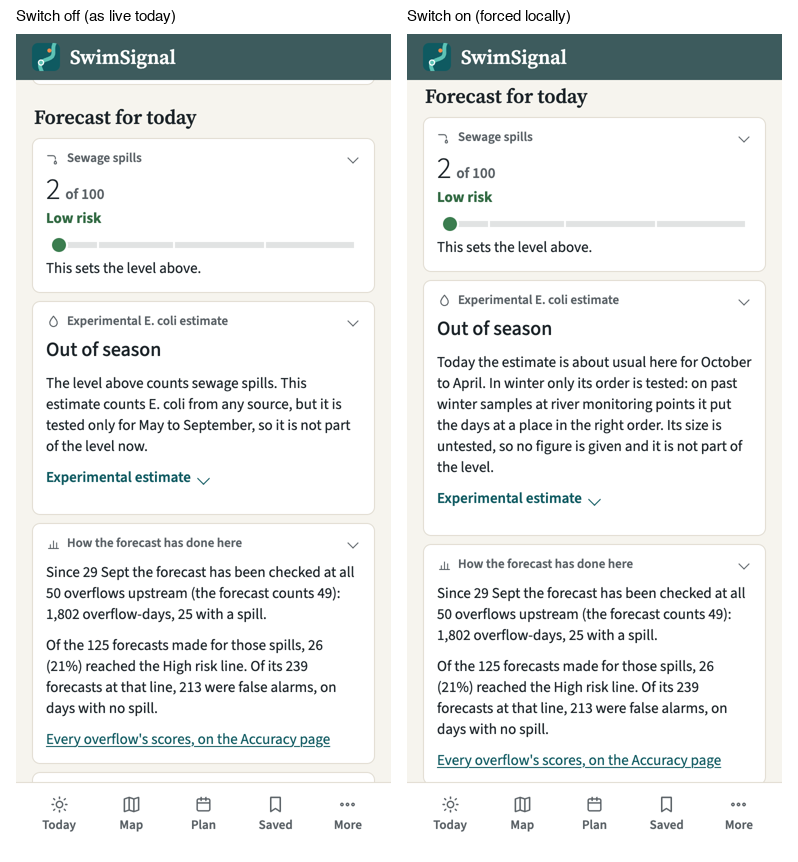
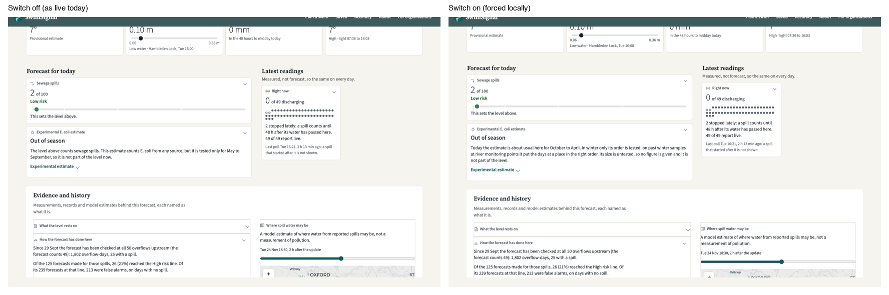

# The river line in winter: built, switched off

24 November 2026. Ethan, the same day, on the proposal in [RIVER-WINTER-READ-2026-11.md](RIVER-WINTER-READ-2026-11.md):
"Build it, switched off. Decide on switching it on when you can see it." This is that build. **The switch is off.
While it is off no forecast, published file or page differs from before.** Switching it on is a separate decision
and has not been made.

## What it does when switched on

At a listed river spot with overflows upstream, from October to April, today's day carries one word: higher, lower
or about. The spot's page shows it in the E. coli tile, which out of season is named "Experimental E. coli estimate"
and reads "Out of season":

> Today the estimate is higher than usual here for October to April. In winter only its order is tested: on past
> winter samples at river monitoring points it put the days at a place in the right order. Its size is untested, so
> no figure is given and it is not part of the level.

The tile's figure still reads "Out of season". There is no percentage and no band. The level, the answer, alerts
and every other tile are unchanged. The method page gains one paragraph.

Since 25 November 2026 (the pull request "Redesign: the winter word in the E. coli row") the redesign's
"E. coli estimate, experimental" row in "Behind the level" reads the word too, with the same two sentences, on the
day that carries it. Its value still reads "Out of season".

It keeps to the three points Ethan read before saying yes:

1. **Today only.** The read was at lead 0 with the day's measured rain, so the word goes on today's day and on no
   later day (`forecast.py`: `days[j] == now.floor("D")`).
2. **No percentage and no change to the level rule.**
3. **The word comes from the figure that passed**: the river model without soil moisture,
   `data/processed/ecoli_model.json` (SHA-256 `7daf7c8e…`). The forecast keeps that figure aside before the
   soil-moisture model replaces it, and the cut-points were made from the same file.

## How to switch it on

Set the repository variable `DIPCAST_RIVER_WINTER_LINE` to `1` (GitHub, Settings, Secrets and variables, Actions,
Variables). `site.yml` passes it to the build. The next build puts the word on today's day and the paragraph on the
method page. To switch it off, delete the variable or set it to anything else; the next build is as before.

**Switching it on reverses part of a recorded decision.** DESIGN's rule of 20 October 2026, "The E. coli estimate
out of season", keeps every E. coli figure out of view from October to April because the estimate was untested
then. This shows one order word from that estimate, and no figure. The reason: its order has since been tested on
winter samples it never saw.

## The cut-points

`data/processed/river_usual_winter.v1.json`, rule `river-usual-winter-v1`, frozen (SHA-256 `8c9dc701…`, checked by
the code; another file switches the word off).

- Made by `scripts/river_usual_winter.py`, offline, from rain already on disk (Open-Meteo archive, 340 cells, 2023
  to 2026). No request was made.
- 69 river spots, the same 69 that have in-season cut-points. 732 to 768 days each, from 1 February 2023 to 11
  November 2026. January 2023 is left out because the rain on disk starts on 1 January 2023 and one spill input sums
  30 days.
- Each spot's cut-points are the thirds of its own figure on those days. Middle values across spots: 0.153 and
  0.444. In season they were lower (at Cromwheel 0.161 and 0.396 in season, 0.223 and 0.526 in winter).
- The 15 river spots with no overflow upstream get no word, as in season.

## What it looks like

Real spots on 24 November 2026. The word for each came from this branch's forecast code, run on this Mac with the
switch on, on the day's live forecast rain. The pictures are the live pages with this branch's page script in place
of the live one and, for "on", that word added to today's day.

| Spot | Word today | Level today | Rain in 48 h |
|---|---|---|---|
| Wharfe at Cromwheel, Ilkley | higher | moderate (0.305) | 4.7 mm |
| River Dart, Spitchwick | higher | moderate (0.381) | 40.7 mm |
| River Thames, Henley-on-Thames | about | low (0.014) | 0.0 mm |
| River Avon, Warleigh Weir | about | low (0.118) | 0.3 mm |
| River Cam, Grantchester Meadows | about | low (0.034) | 0.3 mm |
| River Wye, Hereford | about | low (0.044) | 1.1 mm |

With the switch off the same run gave no word at any of the six, and every other value was identical.

## One thing to look at before deciding

**A dry day in November reads "about usual", not "lower".** Henley had no rain in 48 hours and reads "about". The
cause is the model's time-of-year terms: its figure runs higher in early winter and lower in spring whatever the
rain, and "usual" is taken over the whole of October to April. Across the 69 spots' winter days:

| | Higher | About | Lower |
|---|---|---|---|
| All days, October to January | 44% to 51% | 30% to 37% | 18% to 23% |
| All days, February to April | 13% to 26% | 30% to 39% | 39% to 57% |
| Dry days (under 1 mm in 48 h), October to January | 1% to 2% | 40% to 45% | 53% to 58% |
| Dry days, February to April | 0% | 4% to 8% | 92% to 96% |
| Wet days (10 mm or more), October to January | 98% to 100% | 0% to 2% | 0% |
| Wet days, March and April | 70% to 72% | 28% to 30% | 0% |

So the word follows the rain, with a lean by month. The winter read found the time-of-year terms neither help nor
hurt the order (0.484 with them, 0.484 without, month means removed). Two ways to take the lean out, neither built,
because Ethan approved the figure as it passed:

- make the word from the same figure without its time-of-year terms (scored in the same read, as a reported figure,
  not the deciding one); or
- take "usual" from the spot's days in the same month, and say "for November".

The word changes from one day to the next on 28% of days.

## What was checked

- With the switch off: `winter_direction` gives nothing whatever the file says; the forecast run for six real spots
  has no `ecoli_usual_winter` and is otherwise identical to the run with it on; the out-of-season tile's words are
  exactly as before; the method page is byte-for-byte the page without the marker (tests).
- With it on: the three words at their cut-points, October to April only; the word on today's day and no other
  (the six spots above); no figure or band in the tile.
- The frozen file's hash, its model hash and that it covers the same spots as the in-season file.
- Shared inputs had the same listing hash before and after. 60 weighted Open-Meteo calls were made from this Mac
  for the six spots' forecasts, in a scratch cache with its own ledger.

Not checked: a full site build with the switch on (the six spots ran through `forecast_point`, not `build_site`);
the organisers' page, the decision record, the day-by-day table and the shared picture, which do not show the word;
the redesign preview at `/preview/`, which did not read the new field then (it does since 25 November: above); a screen reader. The data page
(`data.html`) does not describe the new field `ecoli_usual_winter`; it does not describe the in-season one either.

## What stays as it was

The reserve half of the winter samples (odd winters) is still sealed. This build read no sample.
