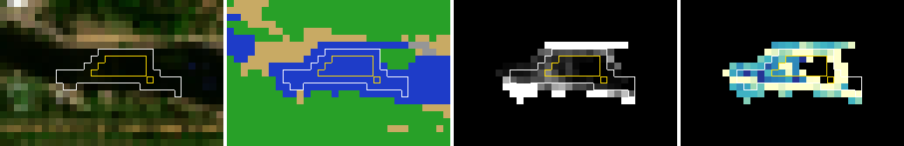
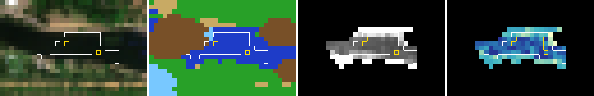
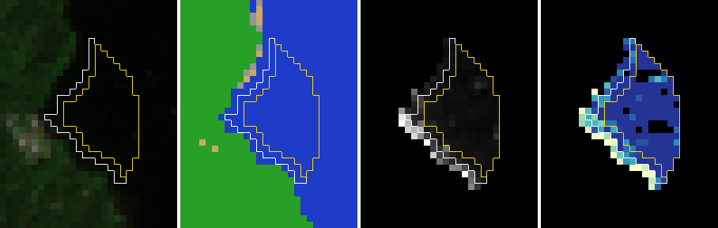
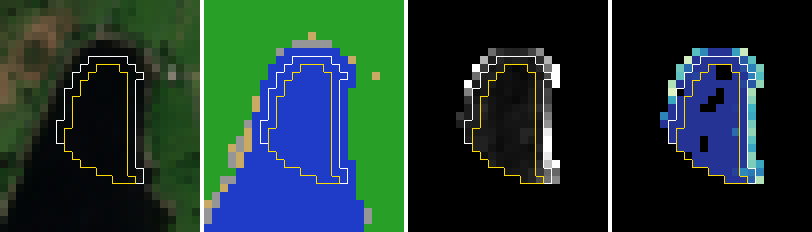
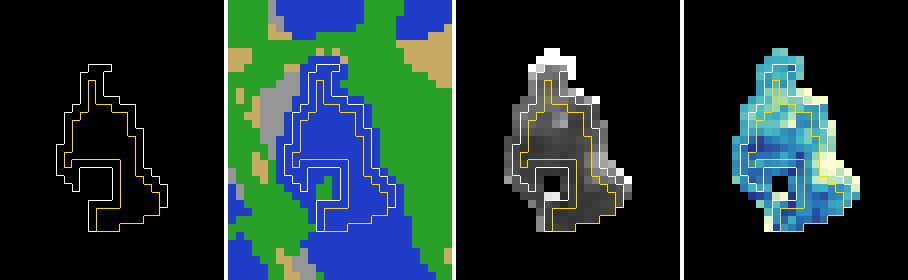

# Shore-margin outliers: what is in the images, and a flag for readings that depend on the mask (exploratory)

Written 5 November 2026 ([#623](https://github.com/ethanbuckley/swimsignal/pull/623)), protocol first, before any new pixel was fetched. Follow-up to the
[shore-margin check](SATELLITE-SHORE-MARGIN-2026-11.md) ([#620](https://github.com/ethanbuckley/swimsignal/pull/620)) and
the two [band samples](SATELLITE-SHORE-BANDS-2026-11.md) ([#621](https://github.com/ethanbuckley/swimsignal/pull/621),
[#622](https://github.com/ethanbuckley/swimsignal/pull/622)). Bounded exploration under the
[research workflow](RESEARCH-WORKFLOW.md), SAT-OBS. **Exploratory, on seen imagery.** It changes no reading, no published
file, no forecast and no protocol; the 2027 evaluation stays frozen. A satellite index is not a toxin measurement, an
algae forecast or swimming clearance, and nothing here says a flagged or unflagged reading is accurate.

## 1. The question

Two 50-scene samples found that moving the shore margin from one to two pixels usually shifts a reading by about 0.004
NDCI, but 13 of 98 distinct scenes shifted by 0.02 or more and one (the Serpentine, 24 June 2026) by 0.23. Why, and
can a reading carry its own warning when it is sensitive to which pixels it was taken from?

## 2. What the caches already say (offline, no fetch; read before fixing the protocol)

Everything in this section used only the cached scene classification, masks and one-pixel readings, plus the second
sample's 50 band windows, which were still in that session's scratch directory. These findings shaped the protocol
below, so they are development observations, not tests.

**The readings around the outliers.** The Serpentine's one-pixel reading of 0.24 on 24 June 2026 sits among readings of
0.15 to 0.41 at that site through June and July 2026; it is the two-pixel value (0.007) that is out of line with the
series. In the second sample, two other summer Serpentine scenes (25 Aug 2025, 16 Jul 2026) read 0.24 and 0.27 at both
margins, with the inner pixels no lower than the ring. The two Lake District outliers are different: Windermere
(`ukd1203-45625`) read −0.41 on 12 July 2025 on tile 30UVF while the same acquisition on tile 30UWF read −0.14, and
Coniston (`ukd1230-45775`) read −0.47 from Sentinel-2B at 11:21 on 18 May 2025 while Sentinel-2A read −0.04 at 11:33.

**Same-day disagreement is common.** 393 of 1,305 usable site-dates have more than one usable reading (two tiles of the
same pass, or two satellites 12 minutes apart). Their range has median 0.03 and 90th percentile 0.17; 17.6% differ by
0.10 or more. Pairs from two satellites differ more (median 0.07) than two tiles of one pass (0.03). Every one of the 13
two-satellite pairs that differ by 0.20 or more has one reading at or below −0.21 (one exception: the Serpentine, 0.18
against 0.41). 50 of the 1,744 usable readings are at or below −0.3; 43 of them are at the Windermere, Coniston and
Derwent Water sites.

**Pixels in the second sample.** Across its 50 scenes, the six that shifted by 0.02 or more fall into two groups:
- three with a median B4 + B5 reflectance over the core of 0.007 to 0.012 and an interquartile range of pixel NDCI of
  0.28 to 0.43 (the other 44 scenes: median brightness 0.033, IQR 0.055). At such low reflectance the index is a ratio
  of two numbers a few digitisation steps above the processing offset, so pixel values scatter widely and the median
  depends on which pixels are kept;
- three at sites where the two-pixel margin removes 39 to 68% of the core (the Serpentine, Windermere Fellfoot,
  Colwick), leaving 22 to 24 inner pixels; their brightness and IQR were ordinary.

**Geometry alone is weak.** The share of the core removed by the two-pixel margin is known for every scene from the
masks. A flag at 0.40 or more marks 35 of the 98 sampled scenes and catches 7 of the 13 that moved (median absolute
shift 0.0085 among flagged against 0.0034 unflagged). The Lake District movers are on wide water (share 0.22 to 0.29).

## 3. Protocol (fixed before the fetch)

**Scenes.** Three sets, selected offline from cached values; no pixel of these scenes had been seen.
- A. The first sample's seven scenes that shifted by 0.02 or more (the second sample's six already have pixels).
- B. Three partners: the 12 July 2025 Windermere scene on the other tile (30UWF), the 18 May 2025 Coniston Sentinel-2A
  scene, and the Serpentine scene of 26 June 2026 (two days after the outlier; one-pixel reading −0.10).
- C. A same-day pair test: among site-date-tile pairs read by two satellites, four with a range of 0.20 or more and four
  with a range of 0.02 or less, at most one pair a site, chosen by a seeded permutation (seed 20261105) after
  excluding scenes already in A or B. The 18 May 2025 Coniston pair, already in A and B, counts as a fifth big pair.
- True-colour (TCI) windows for four scenes only: the Serpentine on 24 and 26 June 2026, Windermere 12 July 2025
  (30UVF), Coniston 18 May 2025 (Sentinel-2B).

**Reads.** `python scripts/satellite_shore_outliers.py prepare|read|report`. B4 and B5 windows through the existing
reader, same scale, offset and mask rules; TCI on the 10 m window. One run, at most **200 requests and 120 MiB**, no
account, stop on the first HTTP error, cap or mismatch, no retry; a partial run stays partial. Every one-pixel reading
must equal the cached one within 1e-6. SHA-256 over every cached input file before selection, before the fetch and after
it. Pixels stay in scratch; the record publishes values only, plus pictures of the inspected scenes.

**Per scene:** readings at margins 0, 1 and 2; clear core pixels; inner pixels; the share the two-pixel margin removes;
median B4 + B5 reflectance over the clear core ("brightness"); IQR of pixel NDCI over the clear core; ring-minus-inner
median NDCI ("contrast"); pixels in the core classed as not water.

**Flags proposed** (thresholds fixed from the second sample, section 2, so exploratory; none uses the two-pixel reading):
- *dark*: brightness below 0.015;
- *spread*: IQR at or above 0.10;
- *narrow*: the two-pixel margin removes 40% or more of the core.

**What is reported** (descriptive counts, no significance claims, nothing adopted):
- H1, the pair test: in each big pair, whether the scene with the larger |reading| is dark or spread; in each small
  pair, whether either scene is. The expectation written down beforehand: big pairs mostly yes, small pairs mostly no.
- H2, the Serpentine outlier: ring-minus-inner contrast on 24 June 2026 against 26 June 2026 and the two cached summer
  scenes, and what the true-colour picture shows over the inner pixels and the shore.
- Each flag against a shift of 0.02 or more on the fetched scenes and on the second sample (the latter is the data the
  thresholds came from, and says so).
- Pictures: true colour, scene classes and NDCI over the site's water, with the one-pixel mask outlined in white and the
  two-pixel mask in yellow, for the four TCI scenes and the first sample's movers.

**Not claimed:** that any flag detects algae, that a flagged reading is wrong or an unflagged one right, or which margin
is closer to lab chlorophyll. Those need the 2027 confirmation data under its own protocol.

## 4. Results (5 November 2026)

**Run.** 26 scenes at 11 sites read in one run: **118 requests, 75,786,848 bytes (72.3 MiB)**, every response 200 or 206,
no retry, under the 200-request and 120 MiB caps. The SHA-256 over the 9,275 cached input files was
`53233d33134b55ae47680809d32e51dae4c40ad1c6ba776363a3ef885a09efde` before selection, before the fetch and after it, the
same value as [#621](https://github.com/ethanbuckley/swimsignal/pull/621)'s. All 26 recomputed one-pixel readings equal the
cached ones (largest difference 0). Per-scene values: [`data/research/satellite_shore_outliers_2026_11.json`](../data/research/satellite_shore_outliers_2026_11.json)
(the second sample's 50 scenes are in it too, as `second_sample_rows`). The protocol commit (`f3ba43b9`, 22:46 UTC) precedes
the fetch; like the two band samples, it is not independently timestamped outside this work session.

### 4.1 What the images show

Pictures: true colour, scene classes (blue water, green vegetation, tan bare ground, brown cloud shadow, grey cloud),
B4 + B5 reflectance over the site's water (black 0 to white 0.06), and NDCI over the site's water (dark blue −0.2 to pale
yellow 0.4); the one-pixel mask is outlined in white, the two-pixel mask in yellow.

**The Serpentine outlier (24 June 2026, 0.24 to 0.007) is dark water, not a shore bloom.** The water is nearly black in
true colour. Over the 22 inner pixels the median B4 reflectance is 0.0005 and B5 0.0025: five and twenty-five
digitisation steps above the product's offset. 16 of the 69 clear core pixels have B4 or B5 at or below zero and are
dropped by the existing rule. At this level one step of 0.0001 in one band moves a pixel's NDCI by about 0.015, and
the stated absolute accuracy of the surface reflectance (of the order of 0.005) is larger than the signal. The 47
one-pixel ring pixels, one pixel from a tree-lined bank, are four times brighter (B4 + B5 median 0.011 against 0.0026)
and read 0.25 against 0.007 inside: a trace of vegetation light, which has far more red-edge than red, sets the index
where the water itself has almost none. The two-pixel reading is not "right" either; the scene has too little signal
for any ratio. Two days later (26 June) the same water is ten times brighter (0.021) and both margins agree within 0.03.
The site's run of high June and July 2026 readings is mixed: the 16 June pair reads 0.18 (Sentinel-2A, brightness
0.029) and 0.41 (Sentinel-2B, 0.009, dark), while 16 July 2026 (0.27, brightness 0.063) and 25 August 2025 (0.24,
0.050) are bright, with inner and ring pixels agreeing. The Serpentine does read high in summer in bright scenes; the
dark scenes exaggerate it.

**The Lake District outliers are the same mechanism at its extreme.** Windermere on 12 July 2025 (tile 30UVF) and
Coniston on 18 May 2025 (Sentinel-2B) are black in true colour; inner B5 medians are 0.0007 and 0.0010, below B4, so
the index is strongly negative (−0.49 and −0.52 inside) and less so at the brighter shore ring (−0.20 and −0.31),
which is why the two-pixel margin moves them further. Their partners show what the water looked like with signal: the
same Windermere acquisition on tile 30UWF has inner brightness 0.0076 and reads −0.15 (still dark, still spread); the
Coniston Sentinel-2A pass 12 minutes later has brightness 0.035 and reads −0.04 at both margins, with no shift. Two
tiles of one acquisition differing by 0.27 at the same pixels shows the per-tile atmospheric correction adding its own
offset to water this dark.

**The Cotswold scene (15 June 2021, shift −0.023)** is a different case: cloud shadow and thin cloud cross the site, the
clear pixels are patchy in brightness and index (IQR 0.17), and the shift comes from which patches each margin keeps.
Derwent Water 18 June 2021 (−0.030) is similar (IQR 0.12, brightness 0.019).

**Not seen in any inspected scene:** core pixels classed as not water (0 in all 26), or a shallow-bottom or vegetation
band visible in true colour inside the one-pixel mask. Shore brightening is visible at every site as a one-pixel rim.

### 4.2 H1, the pair test

| Pair | Readings (cached) | Brightness | IQR | Scene with the larger reading is dark or spread |
|---|---|---|---|---|
| Rutland Whitwell Creek, 29 Jun 2026 | −0.020 / −0.285 | 0.041 / 0.007 | 0.11 / 0.29 | yes (Sentinel-2B) |
| Rutland Sykes Lane, 29 Jun 2026 | −0.003 / −0.210 | 0.074 / 0.014 | 0.02 / 0.12 | yes (Sentinel-2B) |
| Derwent Water, 16 Aug 2025 | −0.085 / −0.358 | 0.014 / 0.010 | 0.14 / 0.24 | yes (both dark) |
| The Serpentine, 16 Jun 2026 | 0.178 / 0.411 | 0.029 / 0.009 | 0.10 / 0.24 | yes (Sentinel-2B) |
| Coniston Monk Coniston, 18 May 2025 | −0.040 / −0.467 | 0.032 / 0.005 | 0.05 / 0.30 | yes (Sentinel-2B) |
| Colwick, 9 Jul 2026 (small) | −0.064 / −0.066 | 0.021 / 0.020 | 0.07 / 0.07 | neither flagged |
| Rutland Whitwell Creek, 29 Jul 2026 (small) | 0.039 / 0.032 | 0.035 / 0.033 | 0.05 / 0.06 | neither flagged |
| Cotswold, 9 Jul 2026 (small) | 0.058 / 0.064 | 0.084 / 0.036 | 0.06 / 0.12 | Sentinel-2B spread (0.117) |
| The Serpentine, 2 May 2025 (small) | 0.080 / 0.069 | 0.057 / 0.056 | 0.05 / 0.04 | neither flagged |

As written down beforehand: **5 of 5 big pairs** have their extreme scene dark or spread (every one is dark), and
**1 of 4 small pairs** has a scene flagged, by the spread rule at 0.117, just over its line. In all five big pairs the
dark scene is the Sentinel-2B pass; these are five pairs, not a statement about the satellites. The two Rutland pairs
are the same two acquisitions at two sites, so they are not independent.

### 4.3 The flags against a shift of 0.02 or more

| Data | Scenes | Moved | *dark* flagged / moved caught / moved missed | *spread* | *narrow* | any of the three |
|---|---|---|---|---|---|---|
| Fetched (enriched with movers by design) | 26 | 11 | 9 / 6 / 5 | 17 / 11 / 0 | 16 / 6 / 5 | 24 / 11 / 0 |
| Second sample (where the thresholds came from) | 50 | 6 | 8 / 3 / 3 | 9 / 3 / 3 | 19 / 4 / 2 | 26 / 6 / 0 |
| Both | 76 | 17 | 17 / 9 / 8 | 26 / 14 / 3 | 35 / 10 / 7 | 50 / 17 / 0 |

Median absolute shift, both sets: 0.022 among *spread*-flagged scenes against 0.004 unflagged; 0.026 against 0.004 for
*dark*; 0.010 against 0.004 for *narrow*. *Dark or spread* together flag 27 of 76 scenes and catch 14 of the 17 movers;
the three missed are the narrow-geometry sites with ordinary signal (Windermere Fellfoot 2020, Colwick 2023, the
Serpentine 16 July 2026), where the shift is 0.020 to 0.023 and the same sign is not guaranteed. In the second sample,
the nearer thing to a cross-section of usable scenes, *dark or spread* marks 10 of 50 (20%); *narrow* marks 19 of 50
because it is a property of the site, not the scene: 6 of the 18 bathing site-tiles remove 40% or more of their core
at two pixels (the Serpentine 68%, Windermere Fellfoot 53%, Rutland Whitwell Creek 51%, Colwick 49%, Cotswold 43%).

These are counts on 76 seen scenes chosen for this question, with thresholds set on 50 of them. They say the flags
point at the right scenes, not how often they fire across the archive (no pixels exist for the other 1,668 usable
scenes) or how a flagged reading relates to chlorophyll.

### 4.4 What this means for the reading

1. The largest shore-margin shifts are not caused by the shore mask being one pixel too narrow. They occur in scenes
   where the water's reflectance is a few thousandths, so the index is a ratio of noise, and any brighter pixel (a
   shore rim, a cloud edge) steers the median. A two-pixel margin moves the reading in such a scene without making it
   meaningful. The margin decision stays as it is.
2. The same scenes explain most of the same-day disagreement in the archive (section 2): 50 readings at or below −0.3,
   nearly all in the Lake District, are of this kind. Dark water is also what clear, deep water looks like, so a dark
   scene must not be read as "no algae" any more than as a high index.
3. A reading can carry its own warning from data it already has. The pilot's refresher stores the class counts of the
   core and the valid-index count, but not brightness, pixel spread or the two-pixel reading.

### 4.5 Next deliverable (proposal; nothing here is implemented)

- **Record at reading time** (weekly pilot, `refresh_lake_observations.scene_quality`, contract minor version): the
  core's median B4 + B5 reflectance, the IQR of pixel NDCI, and the two-pixel reading beside the one-pixel one. No extra
  request: the bands are read anyway. From the next pilot run these accumulate prospectively, so the 2027 confirmation
  can test the flags on unseen scenes without re-reading imagery.
- **Show, do not hide:** on `/lakes.html`, a reading whose brightness is below 0.015 or whose IQR is at or above 0.10
  gets a low-signal note ("very dark water in this image; the index is unreliable"), in the same words for high and low
  values. Readings are not removed and nothing is backfilled. The thresholds are provisional and belong to the 2027
  protocol review.
- **The test that would settle it** (2027 shallow-lake protocol review, before 1 May 2027): pair each flagged and
  unflagged reading with its lab chlorophyll within the stated window, and compare the within-lake rank correlation
  and the paired-shift distribution with and without the flagged readings, and at margins 1 and 2, on scenes read
  after the flags were fixed. Pre-state the margin of usefulness. Until then the flags are a quality note, not a
  claim about accuracy, algae or safety.

## 5. Not claimed

- That a flagged reading is wrong or an unflagged one right; the flags mark readings whose value depends on the pixels
  kept, which is a reproducibility property, not an accuracy measurement.
- Anything about algae, toxins or whether water is safe, at the Serpentine or anywhere else.
- That the two-pixel margin is better or worse against lab chlorophyll.
- That Sentinel-2B scenes are darker in general: five pairs went that way, and a view-angle or correction cause is a
  guess.
